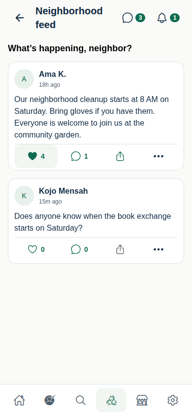
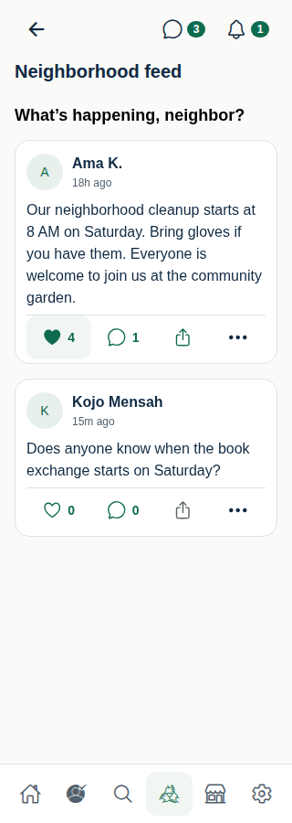
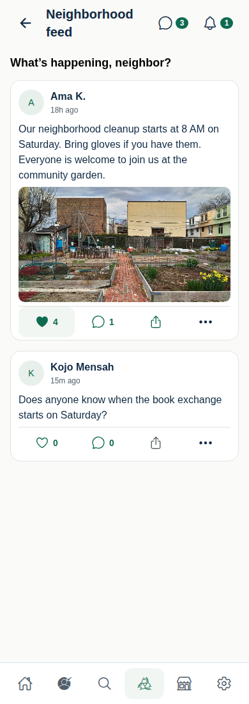
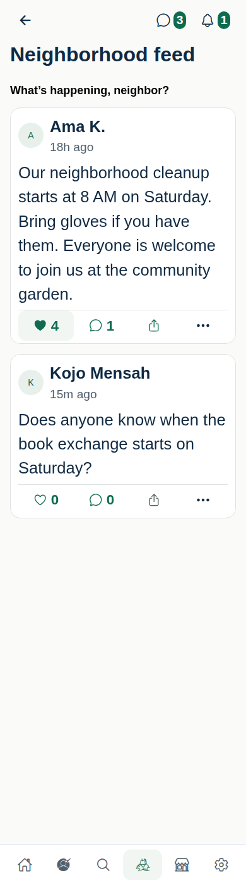
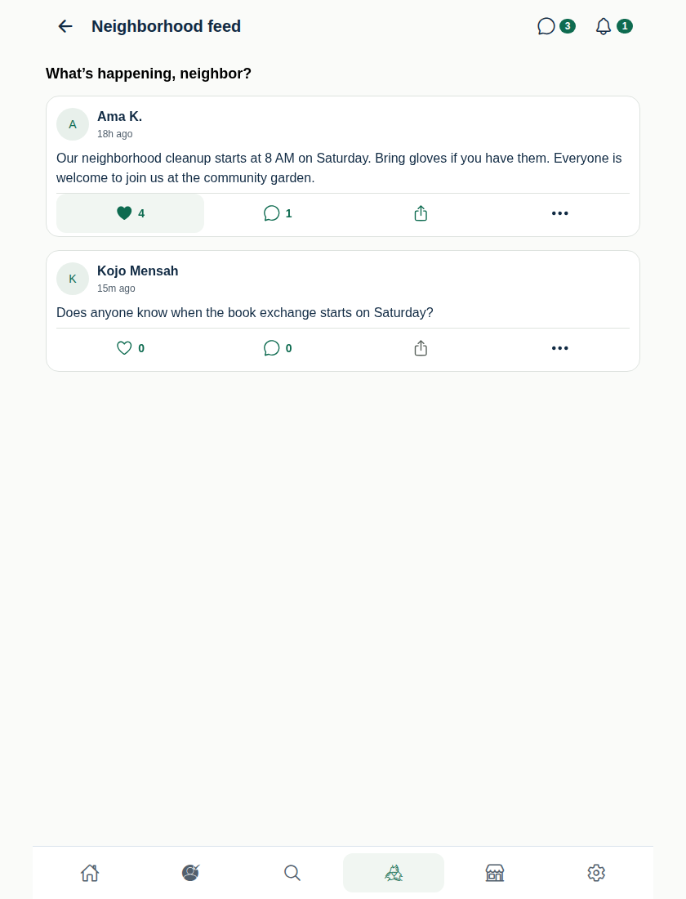

# Neighborhood Feed — compact action bar review

PR: [#182](https://github.com/pushee-io/My-Corner-Trusted-People/pull/182)  
Branch: `codex/home-media-expressive-characters-2026`  
Base main: `a93606447c810a40825bc023b761434c9cd165cc`  
Starting PR head: `d1c23f82263eb20c1af7247584889adcc665efb8`  
Application revision: `0e762c656e65f56b99c35db7837df70aae8fe7ac`

Status: **READY FOR FOUNDER VISUAL REVIEW**.

## Correction

The Feed now uses one horizontal action row beneath each post: heart/count, comment bubble/count, Share icon, and Post options. The existing Ionicons family is used. Like/Unlike and Share words are removed from this Feed row; spoken labels, reaction selection, comment expansion state and share authorization remain. Report appears only after opening Post options.

The production `FeedPostCard` renders the public avatar/name and relative timestamp, unchanged post body/truncation, authorized media, and the new row. Card padding is now 12 horizontally, 10 above and 4 below; internal gaps are 6. Every primary action retains a minimum 48 × 48 dp target. The author identity link also has a 48 dp minimum height. No global design token changed.

`CollapsibleComments` accepts an optional trigger renderer. Feed supplies the compact row through that renderer; other screens retain their existing trigger. The modal, replies, draft ownership, keyboard-first Android Back behavior, session cleanup and submission guard are unchanged. Repository calls, RLS, media permissions, public identity resolution and the link-only sharing gate are unchanged.

## Validation

- Local targeted checks: **4 suites / 29 tests passed** (Feed, collapsible comments, Home preview and post-body behavior).
- TypeScript, changed-file ESLint, formatting and Android bundle export passed. No APK generated.
- New interaction coverage checks the ordered four-control row, icon/count treatment, zero comment count, selected reactions, allowed/disabled sharing, comment expansion, keyboard-first Back and draft retention.
- CI: full mobile tests, formatting, lint, TypeScript, web export, screenshot capture and Android export passed. See [Mobile CI](https://github.com/pushee-io/My-Corner-Trusted-People/actions/runs/38107613056).
- All five Feed screenshots below were inspected: no action wrapping, overlap or clipped counts at 320/390/840 px or simulated enlarged text. Full mobile CI: **121 suites / 735 tests passed**; lint reports zero errors and 69 existing warnings. Database CI passed.
- The final evidence commit changes documentation and PNG evidence only; application code is the tested revision above.

## Founder acceptance checklist

| Check | Result |
| --- | --- |
| Like is icon-first | YES |
| Comment is icon-first | YES |
| Share is icon-first | YES |
| Comment count is visible, including zero | YES |
| Separate Comments text row removed from Feed | YES |
| Report remains in overflow | YES |
| Card vertical whitespace reduced | YES |
| Touch targets remain accessible (48 dp minimum) | YES |
| Feed visually consistent with premium Home direction | YES — reviewed browser fixtures; founder approval pending |

## Screenshot gallery

Images below render the **actual production post-card component** in React Native Web. People, counts and content are test-only fixtures; media is a fixture image injected into the gallery slot. These are not authenticated Feed screenshots or native Android captures. Enlarged text is simulated browser text scaling.

### Standard phone — 390 px

### Compact phone — 320 px

### Post with media

### Enlarged text

### Tablet — 840 px

## Remaining native verification

Physical-device TalkBack, native Share sheet, actual keyboard/Back interaction, real media and scrolling remain untested for this correction. Automated tests cover the retained interaction paths. The local browser installation failed; CI's existing Chrome supplies the screenshots without buying a binary.

No merge, Production deployment, database change or APK build was performed. This correction is limited to Feed presentation and its verification; it does not claim completion of the broader modernization program.
